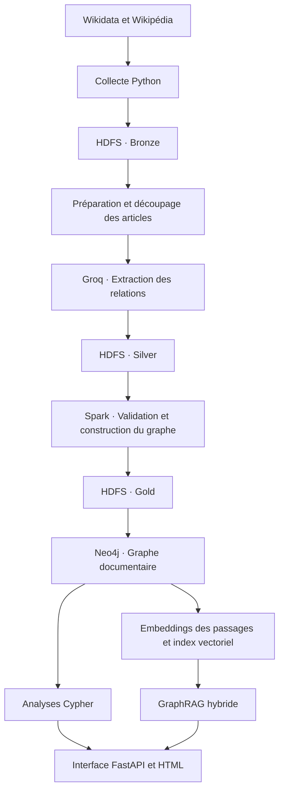

# OrgGraph — Knowledge Graph Analytics & GraphRAG

Plateforme de construction et d’exploration d’un graphe de connaissances sur les organisations et leurs dirigeants à partir de Wikidata et Wikipédia.

Le projet compare deux approches : les analyses structurées en Cypher et les réponses en langage naturel produites par un GraphRAG hybride avec citations.

## Architecture



## Technologies

| Composant | Technologie |
|---|---|
| Collecte | Python, Requests, BeautifulSoup |
| Stockage distribué | HDFS |
| Extraction des relations | Groq — `openai/gpt-oss-120b` |
| Validation et transformations | Apache Spark |
| Graphe et index de recherche | Neo4j |
| Embeddings multilingues | `intfloat/multilingual-e5-small` |
| Interface | FastAPI, HTML, JavaScript, vis-network |
| Infrastructure | Docker Compose |

## Données

Le corpus collecté comprend :

- **220 articles Wikipédia** ;
- **2 315 chunks**, tous traités par le LLM ;
- **2 766 extractions acceptées** avant validation Spark ;
- **2 762 extractions validées** et **4 mises en quarantaine**.

Ces nombres décrivent les extractions avant regroupement en assertions dans le graphe. La validation technique ne garantit pas la justesse factuelle de chaque relation.

## Structure

```text
crawler/                    Collecte Wikidata et Wikipédia
extraction/                 Chunking, extraction Groq et upload LLM
spark/
  validate_extractions.py   Validation et quarantaine
  build_document_graph.py  Construction des tables du graphe
enriched/
  common.py                 Configuration et accès Neo4j
  import_graph.py           Import du graphe documentaire
  embed.py                  Embeddings et index de recherche
  rag.py                    Recherche hybride et génération
api/
  main.py                   API principale
  static/index.html         Interface web
config/hadoop/              Configuration HDFS
data/                       Données locales, rapports et caches
```

Les sorties distribuées sont stockées dans HDFS :

```text
/data/orggraph/
├── bronze/
│   ├── wikidata/
│   └── wikipedia/
├── silver/
│   ├── preparation/
│   ├── llm/
│   └── validated/
└── gold/
    └── document_graph/
```

## 1. Installation

Prérequis : Python 3.12, Docker et Docker Compose. Sous Windows, utiliser WSL2 avec l’intégration Docker Desktop activée.

Depuis la racine du projet :

```bash
python -m venv .venv
source .venv/bin/activate
pip install -r requirements.txt
```

Créer `.env` à partir de `.env.example` :

```bash
cp .env.example .env
```

Renseigner :

```dotenv
CONTACT_EMAIL=votre.email@example.com

GROQ_API_KEY=votre_cle_groq
GROQ_MODEL=openai/gpt-oss-120b

NEO4J_URI=bolt://localhost:7687
NEO4J_PASSWORD=votre_mot_de_passe
```

Ne jamais publier `.env` ni les clés API.

## 2. Démarrer les services

```bash
docker compose up -d namenode datanode1 datanode2
```

```bash
docker compose --profile compute up -d \
  spark-master spark-worker1 spark-worker2
```

```bash
docker compose --profile graph up -d neo4j
```

Vérifier leur état :

```bash
docker compose ps
```

| Service | Adresse |
|---|---|
| HDFS NameNode | http://localhost:9870 |
| Spark Master | http://localhost:8081 |
| Neo4j Browser | http://localhost:7474 |
| Interface OrgGraph | http://localhost:8000 |

## 3. Collecter les sources

```bash
python -m crawler.wikidata_collector
python -m crawler.wikipedia_crawler
```

Les fichiers sont enregistrés dans `data/bronze/`.

Copier le corpus vers HDFS :

```bash
docker compose exec -T namenode \
  mkdir -p /tmp/orggraph-upload
```

```bash
docker compose cp \
  data/bronze/. namenode:/tmp/orggraph-upload/
```

```bash
docker compose exec -T namenode \
  hdfs dfs -mkdir -p /data/orggraph/bronze
```

```bash
docker compose exec -T namenode \
  hdfs dfs -put -f \
  /tmp/orggraph-upload/wikidata \
  /tmp/orggraph-upload/wikipedia \
  /data/orggraph/bronze/
```

## 4. Préparer les chunks

```bash
python -m extraction.prepare_chunks
```

La préparation nettoie et découpe les articles en segments avec chevauchement, en conservant leur provenance.

Sorties locales :

```text
data/silver/preparation/
├── wikipedia_chunks.jsonl
└── preparation_report.json
```

Enregistrer ces sorties dans HDFS :

```bash
docker compose cp \
  data/silver/preparation \
  namenode:/tmp/orggraph-upload/
```

```bash
docker compose exec -T namenode \
  hdfs dfs -mkdir -p /data/orggraph/silver/preparation
```

```bash
docker compose exec -T namenode \
  hdfs dfs -put -f \
  /tmp/orggraph-upload/preparation/wikipedia_chunks.jsonl \
  /tmp/orggraph-upload/preparation/preparation_report.json \
  /data/orggraph/silver/preparation/
```

## 5. Extraire les relations avec Groq

Traiter un lot :

```bash
python -m extraction.groq_extract --limit 50 --delay 15
```

Relancer la commande pour poursuivre. Les réponses déjà sauvegardées sont relues depuis le cache sans nouvel appel API.

Les résultats comprennent les relations, les extraits justificatifs, les métadonnées de provenance et le rapport d’extraction.

Uploader les résultats :

```bash
python -m extraction.upload_llm_hdfs
```

## 6. Valider avec Spark

```bash
docker compose --profile compute --profile jobs run \
  --rm --no-deps --use-aliases \
  spark-client \
  /opt/orggraph/spark/validate_extractions.py
```

Le traitement vérifie notamment les champs, les types de relations, la provenance, les citations et les formats de dates. Les extractions rejetées sont conservées en quarantaine.

**Conserver le chemin `output` affiché dans le rapport.**

## 7. Construire le graphe documentaire

Définir le chemin exact obtenu à l’étape précédente :

```bash
export VALIDATED_PATH="hdfs://namenode:8020/data/orggraph/silver/validated/..."
```

Puis :

```bash
docker compose --profile compute --profile jobs run \
  --rm --no-deps --use-aliases \
  spark-client \
  /opt/orggraph/spark/build_document_graph.py \
  --validated "$VALIDATED_PATH"
```

Spark construit les tables :

- documents et chunks ;
- entités et mentions ;
- assertions et preuves.

Les entités sont rapprochées du référentiel Wikidata. Les identités non résolues ou ambiguës restent locales au document pour limiter les fusions incorrectes.

**Vérifier `all_integrity_checks_passed: true` et conserver le chemin Gold affiché.**

## 8. Importer dans Neo4j

Définir le chemin Gold exact :

```bash
export GOLD_PATH="hdfs://namenode:8020/data/orggraph/gold/document_graph/..."
```

Puis :

```bash
python -m enriched.import_graph --gold "$GOLD_PATH"
```

Le graphe relie les connaissances à leurs sources :

```text
KGStatement ──SUBJECT──────► KGEntity
KGStatement ──OBJECT───────► KGEntity
KGStatement ──SUPPORTED_BY─► KGEvidence
KGEvidence  ──FROM_CHUNK───► KGChunk
KGChunk     ──IN_DOCUMENT─► KGDocument
```

Les chemins contenant `...` sont des exemples : les remplacer par les chemins complets des rapports.

## 9. Calculer les embeddings

```bash
python -m enriched.embed
```

Le script découpe les chunks en passages adaptés au modèle d’embedding, calcule les vecteurs et crée les index vectoriel et textuel dans Neo4j.

Les vecteurs calculés sont conservés dans un cache local. Le premier lancement télécharge le modèle.

**Après une réimportation du graphe, relancer cette étape avant le GraphRAG.**

## 10. Lancer l’interface

```bash
uvicorn api.main:app --host 127.0.0.1 --port 8000
```

Ouvrir **http://127.0.0.1:8000**.

L’interface propose :

| Onglet | Fonction |
|---|---|
| Explorer le graphe | Visualiser les entités, assertions et preuves |
| Analyse du graphe | Exécuter des requêtes Cypher |
| Assistant GraphRAG | Récupérer les sources puis générer une réponse |
| Comparer les approches | Afficher Cypher et GraphRAG côte à côte |

La récupération seule n’appelle pas Groq. Une génération non présente dans le cache peut consommer des tokens.

### Utilisation après installation

Si le graphe et les embeddings sont déjà chargés, seuls Neo4j et l’API sont nécessaires pour consulter l’interface :

```bash
docker compose --profile graph up -d neo4j
source .venv/bin/activate
uvicorn api.main:app --host 127.0.0.1 --port 8000
```

## Exemples

### Question GraphRAG

> À quelles organisations Thomas Schäfer est-il lié ? Distingue les fonctions anciennes de celles présentées comme en cours dans les sources.

### Recherche sans génération

```bash
python -m enriched.rag \
  "À quelles organisations Thomas Schäfer est-il lié ?" \
  --entity "Thomas Schäfer" \
  --retrieve-only
```

### Requête Neo4j Browser

```cypher
MATCH (p:KGEntity)<-[:SUBJECT]-
      (s:KGStatement)-[:OBJECT]->(o:KGEntity)
WHERE s.dataset_id = 'orggraph_enriched_v1'
  AND p.name = 'Thomas Schäfer'
RETURN o.name AS organisation,
       s.relation_type AS relation,
       s.temporal_status AS statut
ORDER BY organisation, relation;
```

## Comparaison et limites

- **Cypher** calcule des résultats structurés sur les données stockées : filtres, comptages et regroupements.
- **GraphRAG** combine recherche vectorielle, recherche textuelle et contexte du graphe pour produire une réponse sourcée.
- Le contexte GraphRAG est limité ; une réponse peut ne pas être exhaustive.
- Les fonctions « en cours » correspondent à l’état décrit par la source, pas nécessairement à la situation actuelle.
- Les citations facilitent la vérification, sans garantir la justesse d’une affirmation.
- L’accuracy et le recall doivent être mesurés sur un jeu de référence annoté. L’interface présente les temps d’exécution et les sources récupérées.

## Références

- [Wikidata API](https://www.wikidata.org/w/api.php)
- [MediaWiki API](https://www.mediawiki.org/wiki/API:Main_page)
- [HDFS](https://hadoop.apache.org/docs/r3.2.1/)
- [Apache Spark 3.5](https://spark.apache.org/docs/3.5.0/)
- [Neo4j et Cypher](https://neo4j.com/docs/cypher-manual/current/)
- [Groq](https://console.groq.com/docs/overview)
- [Modèle multilingual-e5-small](https://huggingface.co/intfloat/multilingual-e5-small)
- [FastAPI](https://fastapi.tiangolo.com/)