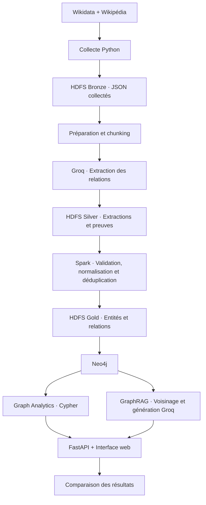

# OrgGraph — Knowledge Graph Analytics & GraphRAG

Plateforme d’exploration des organisations, de leurs dirigeants et de leurs
relations à partir de documents publics.

Les données collectées sont transformées en graphe Neo4j, interrogeable
par requêtes Cypher ou par GraphRAG : récupération des relations pertinentes,
puis génération d’une réponse avec des références aux sources.

## Architecture



## Technologies

Python · Docker Compose · Hadoop HDFS · Apache Spark · Neo4j ·
Groq · FastAPI · HTML/CSS/JavaScript

## Structure

```text
crawler/       Configuration et collecte Wikidata/Wikipédia
extraction/    Préparation, extraction LLM et upload HDFS
spark/         Transformations distribuées
graph/         Import Neo4j, analyses, GraphRAG et mises à jour
api/
  main.py      API FastAPI
  static/      Interface web
config/        Configuration Hadoop
data/
  bronze/      Données collectées
  silver/      Segments et extractions
  gold/        Exports locaux éventuels des résultats Spark
  benchmark/   Questions et réponses attendues
```

Les sorties Spark sont enregistrées dans HDFS. Le dossier local `data/gold/`
contient uniquement les exports effectués pour consultation.

## Installation

### Prérequis

- Python 3.10 ou supérieur.
- Docker avec Docker Compose.
- Une clé API Groq pour l’extraction et la génération.
- Sous Windows : WSL2 avec intégration Docker Desktop.

### Environnement Python

Depuis la racine du projet :

```bash
python3 -m venv .venv
source .venv/bin/activate
pip install -r requirements.txt
```

Pour reproduire les versions exactes, si le fichier est fourni :

```bash
pip install -r requirements-lock.txt
```

### Configuration

```bash
cp .env.example .env
```

Renseigner :

```dotenv
CONTACT_EMAIL=your-email@example.com
GROQ_API_KEY=your_groq_api_key
GROQ_MODEL=openai/gpt-oss-120b
NEO4J_PASSWORD=your_neo4j_password
```

Ne jamais publier `.env`.

## Pipeline

### 1. Démarrer HDFS

```bash
docker compose up -d namenode datanode1 datanode2
```

Vérifier que les deux DataNodes sont disponibles et que le mode de sécurité
est désactivé :

```bash
docker compose exec -T namenode hdfs dfsadmin -report
docker compose exec -T namenode hdfs dfsadmin -safemode get
```

### 2. Collecter les données

Les organisations initiales et les paramètres de collecte sont définis
dans `crawler/config.py`.

```bash
python -m crawler.wikidata_collector
python -m crawler.wikipedia_crawler
```

Résultats locaux :

```text
data/bronze/wikidata/
data/bronze/wikipedia/
```

Si les données sont déjà fournies dans le dépôt, cette collecte peut être ignorée.

### 3. Charger Bronze dans HDFS

```bash
docker compose exec -T namenode mkdir -p /tmp/orggraph-upload

docker compose cp ./data/bronze/wikidata namenode:/tmp/orggraph-upload/
docker compose cp ./data/bronze/wikipedia namenode:/tmp/orggraph-upload/

docker compose exec -T namenode hdfs dfs -mkdir -p /data/orggraph/bronze/wikidata /data/orggraph/bronze/wikipedia

docker compose exec -T namenode sh -c 'hdfs dfs -put -f /tmp/orggraph-upload/wikidata/*.json /data/orggraph/bronze/wikidata/'

docker compose exec -T namenode sh -c 'hdfs dfs -put -f /tmp/orggraph-upload/wikipedia/*.json /data/orggraph/bronze/wikipedia/'
```

### 4. Préparer les segments

```bash
python -m extraction.prepare_chunks
```

Le script lit Wikipédia depuis HDFS, prépare les sections et découpe les textes :

- taille maximale : 4 500 caractères ;
- chevauchement cible : 500 caractères ;
- conservation du document, de la section, du QID et de la révision source.

Charger les résultats dans HDFS :

```bash
docker compose exec -T namenode mkdir -p /tmp/orggraph-preparation

docker compose cp ./data/silver/preparation/wikipedia_chunks.jsonl namenode:/tmp/orggraph-preparation/
docker compose cp ./data/silver/preparation/preparation_report.json namenode:/tmp/orggraph-preparation/

docker compose exec -T namenode hdfs dfs -mkdir -p /data/orggraph/silver/preparation

docker compose exec -T namenode sh -c 'hdfs dfs -put -f /tmp/orggraph-preparation/* /data/orggraph/silver/preparation/'
```

### 5. Extraire les relations avec Groq

Pour reprendre l’extraction configurée :

```bash
python -m extraction.groq_extract --limit 100 --delay 15
```

Les réponses sont sauvegardées individuellement pour permettre la reprise.
Les citations non retrouvées exactement dans le segment sont rejetées.

**Attention :** la version de reprise nécessite le fichier `settings.json`
de l’extraction existante. Elle utilise le modèle enregistré dans ce fichier.

Les réponses brutes exclues de Git ne sont pas disponibles après un clonage :
sans leur cache local, les appels correspondants pourront être refaits.
Pour consulter le MVP, utiliser directement les extractions cumulées fournies.

### 6. Préparer et charger le graphe

Après un lot terminé, une seule commande exécute :

**Upload HDFS → Spark → Synchronisation Neo4j**

```bash
python -m graph.update_graph --import-neo4j
```

Le programme :

- ajoute les nouvelles réponses dans HDFS ;
- actualise les fichiers récapitulatifs modifiés ;
- recalcule les tables cumulées avec Spark ;
- crée un nouveau dossier Gold horodaté ;
- synchronise le graphe actif dans Neo4j.

Aucun appel Groq n’est effectué à cette étape.
Ne pas modifier les fichiers d’extraction pendant la synchronisation.

Après clonage, si le dossier de réponses ignoré par Git est absent,
le recréer avant l’upload des extractions cumulées :

```bash
mkdir -p data/silver/llm/ff7e5205b7ffa21f/responses
```

## Utilisation

### Interface web

```bash
uvicorn api.main:app --reload --host 127.0.0.1 --port 8000
```

Ouvrir : **http://localhost:8000**

Fonctionnalités :

- exploration interactive du graphe ;
- exécution de requêtes Cypher ;
- questions GraphRAG avec citations ;
- comparaison des deux approches ;
- benchmark sur les questions configurées.

Après une mise à jour du graphe, recharger la page et relancer les requêtes.

### Analyses en ligne de commande

```bash
python -m graph.analytics
```

### GraphRAG sans appel LLM

```bash
python -m graph.graphrag \
  "À quelles organisations Thomas Schäfer est-il lié ?" \
  --entity "Thomas Schäfer" \
  --retrieve-only
```

### GraphRAG avec génération

```bash
python -m graph.graphrag \
  "À quelles organisations Thomas Schäfer est-il lié ? Distingue les fonctions anciennes et celles présentées comme en cours dans les sources." \
  --entity "Thomas Schäfer"
```

Ajouter `--hops 2` pour explorer un voisinage à deux sauts.
Une réponse en cache est réutilisée lorsque les paramètres et le contexte
envoyé au modèle sont identiques.

## Services

| Service | Adresse |
|---|---|
| Interface web | http://localhost:8000 |
| Documentation API | http://localhost:8000/docs |
| Neo4j Browser | http://localhost:7474 |
| Neo4j Bolt | bolt://localhost:7687 |
| HDFS NameNode | http://localhost:9870 |
| Spark Master | http://localhost:8081 |

## Données du premier MVP

| Indicateur | Nombre |
|---|---:|
| Articles Wikipédia collectés | 220 |
| Segments préparés | 2 315 |
| Segments traités par le LLM | 1 139 |
| Relations acceptées avant Spark | 1 407 |
| Entités après Spark | 1 229 |
| Relations après déduplication | 1 379 |

Ces chiffres décrivent la première version ; les rapports générés indiquent
l’état des versions suivantes.

## Évaluation et limites

- La résolution des entités repose sur leur type et leur nom normalisé :
  alias et homonymes peuvent subsister.
- Les extractions restent des relations candidates, vérifiables par leurs preuves.
- `current_at_source` signifie « en cours selon la source », pas aujourd’hui.
- GraphRAG utilise un voisinage limité ; une absence de résultat ne prouve
  pas l’absence d’une relation.
- Le benchmark actuel mesure la présence des réponses attendues dans le texte.
  Ce score n’est pas une mesure complète d’accuracy ou de rappel sémantique.
- Les temps de génération en cache doivent être distingués des nouveaux appels.

## Sources et documentation

- [Wikidata](https://www.wikidata.org/)
- [Wikipédia](https://www.wikipedia.org/)
- [Hadoop HDFS](https://hadoop.apache.org/docs/r3.2.1/)
- [Apache Spark](https://spark.apache.org/docs/3.5.0/)
- [Neo4j Cypher](https://neo4j.com/docs/cypher-manual/)
- [Groq](https://console.groq.com/docs/)
- [FastAPI](https://fastapi.tiangolo.com/)

Les données restent soumises aux conditions et licences de leurs sources :
[Wikidata](https://www.wikidata.org/wiki/Wikidata:Licensing) ·
[Wikimedia](https://foundation.wikimedia.org/wiki/Policy:Terms_of_Use).